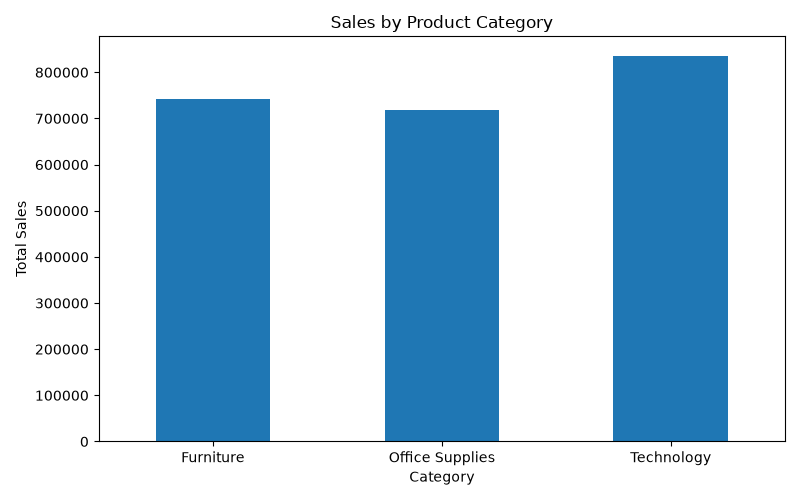
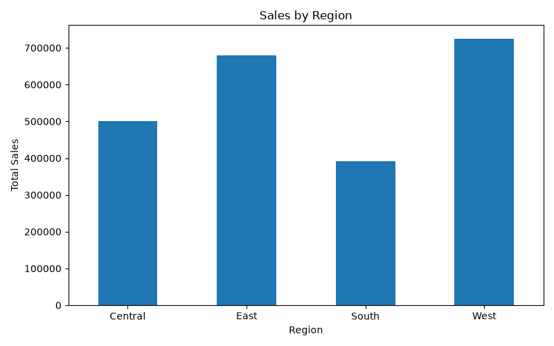
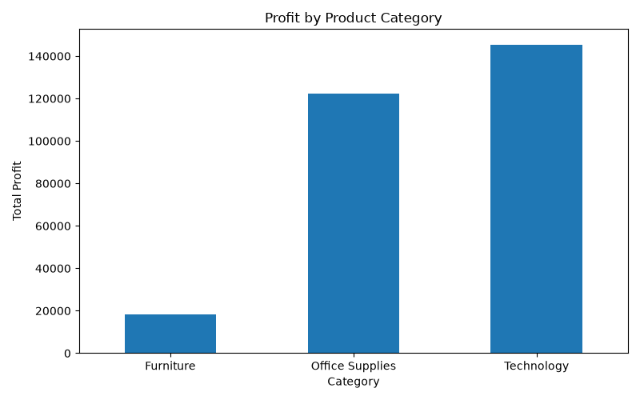

# Superstore Sales Analysis

## Project Overview
This project focuses on analyzing Superstore sales data using Python to identify sales trends, profit performance, and business insights. The analysis helps understand product category performance, regional sales, and monthly sales patterns.

## Objectives
- Analyze sales and profit performance.
- Compare sales across product categories and regions.
- Explore monthly and yearly sales trends.
- Identify top-performing products.
- Create visualizations to present findings clearly.

## Tools and Technologies
- Python
- Pandas
- Matplotlib
- VS Code
- Git and GitHub

## Dataset
The project uses the Sample Superstore dataset, which contains 9,994 records and 21 columns related to orders, products, sales, discounts, profit, and regions.

## Data Analysis Performed
- Inspected dataset structure and column information.
- Checked missing values and duplicate records.
- Generated descriptive statistics.
- Calculated total sales and total profit.
- Analyzed sales and profit by product category.
- Analyzed sales and profit by region.
- Explored monthly and yearly sales.
- Examined sales and profit across discount levels.
- Identified the top 10 products by sales.

## Visualizations

### 1. Sales by Product Category

### 2. Sales by Region

### 3. Profit by Product Category

## Key Findings
The analysis explores differences in sales and profit across product categories and regions. The regional analysis identified the West region as having the highest sales and profit in the dataset.

Additional insights can be developed by examining the category-wise results, top-selling products, and monthly sales trends.

## Project Files
- `analysis.py` — Python code for data analysis and visualizations.
- `Sample - Superstore.csv` — Dataset used for analysis.
- `category_sales.png` — Category-wise sales chart.
- `region_sales.png` — Region-wise sales chart.
- `category_profit.png` — Category-wise profit chart.

## How to Run
1. Install Python.
2. Install the required libraries:
   `python -m pip install pandas matplotlib`
3. Download or clone this repository.
4. Run the analysis:
   `python analysis.py`

## Conclusion
This project demonstrates the use of Python, Pandas, and Matplotlib for exploratory data analysis and business reporting. It provides practice in data inspection, sales and profit analysis, and data visualization.

## Author
Shreya Rayane
